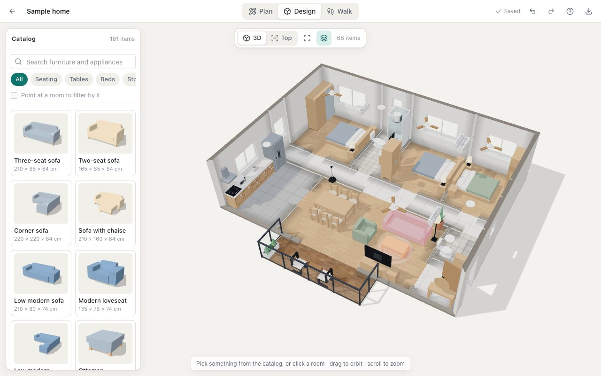
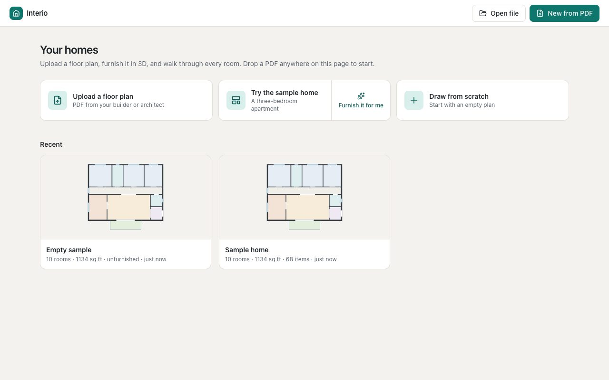
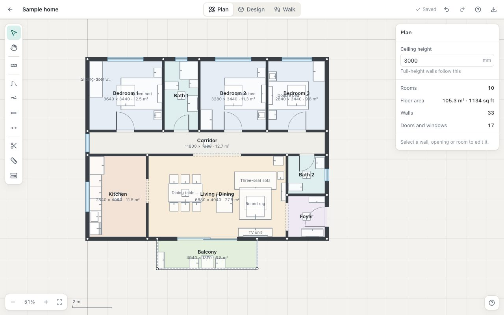
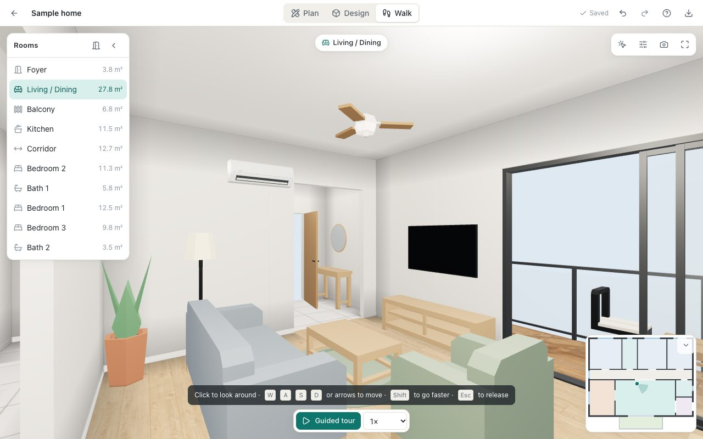

# Interio

Turn a floor-plan PDF into a furnished 3D home you can walk through.

1. **Upload** a floor plan (a PDF from a builder or architect), or drop it anywhere on the page.
2. **Review** the detected walls, doors, windows and rooms, then choose **Furnish it for me** or **Review the plan first**.
3. **Furnish** in 3D from a catalog of furniture and appliances.
4. **Walk** through every room in first person, or take the guided tour.



| Your homes | Plan editor | Walkthrough |
|---|---|---|
|  |  |  |

The screenshots show the built-in sample home. The step-by-step guide is in [docs/USER_GUIDE.md](docs/USER_GUIDE.md), and inside the app under **Help**.

## Features

**Import**
- Reads walls, doors, windows, railings and rooms from the line work of a CAD-exported PDF, with layers, scale and room sizes.
- Review screen with the plan over the drawing, a scale you can override, and a layer table to correct what each CAD layer means.
- Page picker with thumbnails for multi-page PDFs.
- "Things to check" entries zoom to and outline the rooms, walls and openings they refer to; walls and openings read with low confidence are marked in amber.
- Clear messages for password-protected, damaged, empty and oversized files (up to 50 MB).
- Scans and photos: **Trace it yourself** opens the 2D editor with the page underneath.
- Optional AI assist reads room names, labelled sizes and door tags from a picture of the page.

**Plan (2D editor)**
- Draw walls click by click or by typed length, with snapping to corners, walls and the source drawing.
- Doors, sliding doors, windows and open passages; split, measure and set-scale tools.
- Rooms are derived from the walls; each has a name, a type, and a floor and wall finish.
- Full undo and redo.

**Design (3D)**
- Orbit and top views of the home with cut-away walls.
- Catalog of furniture and appliances with search and categories; click or drag to place, with wall snapping.
- Move, turn, duplicate, swap and remove items; overlap warnings.
- Auto-furnish one room, or the whole home in one step.

**Walk**
- First-person walkthrough with collisions, keyboard, mouse and touch controls, minimap and room list.
- Guided tour through every room with pause, skip and speed.
- Field of view, eye height, full screen, and a picture of the current view.

**Projects**
- Stored in your browser (IndexedDB) and saved as you work.
- Rename, duplicate and delete from the dashboard; cards show rooms, floor area and furniture count.
- Export to a single `.interio` file that carries the plan, the furniture, the source drawing and the PDF, and opens in another browser with everything intact.

## Quick start

Requires Node 22+ and pnpm 10+.

```bash
pnpm install
pnpm dev
```

Open http://localhost:5173 and choose **Try the sample home**, or upload a floor plan. The API used by the AI assist runs on port 8787.

To run on other ports (for example, to run two checkouts side by side), set `INTERIO_WEB_PORT` and `INTERIO_API_PORT` in the shell or in `.env`.

## AI assist setup

The AI assist is optional. Without it, the import still reads walls, doors and windows from the PDF; room names and types are then guesses that you can rename in Plan mode. The review screen says which of the two happened.

There are two ways to enable it. For either, copy `.env.example` to `.env` in the repository root, edit it, and restart `pnpm dev`.

| Way | Setting in `.env` | Notes |
|---|---|---|
| Anthropic API key | `ANTHROPIC_API_KEY=<your key>` | Works anywhere. Billed to the key. Default model `claude-fable-5-2`. |
| Claude Code login on this computer | `INTERIO_AI_PROVIDER=claude-code` | No key. Needs [Claude Code](https://claude.com/claude-code) installed and signed in on the same machine. Each import is one small call that counts against your Claude plan's usage. Default model `claude-opus-5-5`. For local use only: a hosted deployment needs an API key. |

With either enabled, a PNG of the page being imported is sent to Anthropic. With neither, nothing leaves your computer. `ANTHROPIC_MODEL` and the tuning options are described in `.env.example`.

## Commands

| Command | What it does |
|---|---|
| `pnpm dev` | Web app and API with hot reload |
| `pnpm test` | Unit tests (Vitest) |
| `pnpm e2e` | End-to-end tests (Playwright, headless Chromium) |
| `pnpm e2e flow` | One spec file, by name |
| `pnpm typecheck` | TypeScript across all packages |
| `pnpm lint` | oxlint |
| `pnpm build` | Production build of the web app |

## Tests

```bash
pnpm typecheck && pnpm lint && pnpm test && pnpm build
pnpm e2e
```

- **Unit tests** cover the plan model and geometry, the importer, the catalog, the API, the editors' logic and the project file format.
- **End-to-end tests** drive the app in headless Chromium. 3D renders through software WebGL, so they need no GPU. The first run needs the browser: `pnpm exec playwright install chromium`.
- The suite starts its own servers on ports 5273 and 8887. Override them with `INTERIO_E2E_WEB_PORT` and `INTERIO_E2E_API_PORT`.
- `tests/e2e/flow.spec.ts` (the whole journey on the sample home) and most of `tests/e2e/import.spec.ts` need no fixtures: they build small PDFs in code.
- The README screenshots are regenerated with `INTERIO_DOCS_SHOTS=1 pnpm e2e flow -g "docs screenshots"`.

### Local fixtures (real floor plans)

Real plans are usually third-party drawings, so they are never committed. Tests that need them skip when they are absent.

1. Put floor-plan PDFs in `fixtures/local/`. Everything in that folder except its README is git-ignored.
2. Optionally record an AI result next to a PDF as `<same name>.vision.json` (a `VisionResult`, see `packages/core/src/schema.ts`). With a key in `.env`, render the page to PNG and run `pnpm --filter @interio/server analyze <page.png> <name>.vision.json`.
3. Run the tests. The importer golden tests (`pnpm test`) and `tests/e2e/import.spec.ts` use any PDF in the folder; `tests/e2e/real-pdf.spec.ts` runs the full journey (import, furnish, guided tour, export and re-import) for every PDF that has a recorded result.

Do not commit the drawings, data derived from them, or screenshots of them.

## Layout

```
packages/core       Plan schema, store with undo, pure geometry (rooms, wall meshes, room graph)
packages/scene3d    three.js scene components shared by the 3D view and the walkthrough
packages/importer   PDF -> plan draft
packages/catalog    Furniture and appliance catalog, auto-furnish
apps/server         API: AI assist for plan import
apps/web            The app: dashboard, import, plan editor, 3D design, walkthrough
tests/e2e           Playwright tests
docs                Contract, user guide, asset records, screenshots
```

See [docs/CONTRACT.md](docs/CONTRACT.md) for the data model, coordinate frames and module boundaries.

## Licence

Apache-2.0. Third-party assets and their licences are listed in [ASSETS.md](ASSETS.md).
